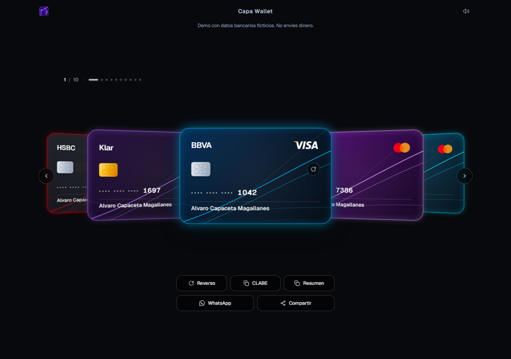
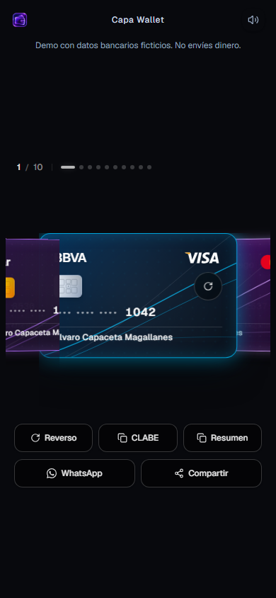

# 💳 Capa Wallet

A visual, tactile bank-card wallet for viewing, copying, and sharing transfer details. Built with React and TypeScript, with a layered 3D carousel, card flips, and a minimal dark interface.

**Fictional banking details only. The demo uses the author's display name, Alvaro Capaceta Magallanes. Do not send money using these identifiers. Capa Wallet does not connect to bank accounts, hold funds, or process payments.**

Planned demo: [wallet.ingcapadev.com](https://wallet.ingcapadev.com) — deployment is pending.

## 🥃 Preview



<details>
<summary>Mobile preview</summary>



</details>

## 🔥 Features

- Layered 3D card carousel with flip and pointer-tilt interactions.
- Responsive layouts, swipe navigation, and keyboard shortcuts.
- One-click CLABE and transfer-summary copying.
- WhatsApp sharing and native sharing where supported, with a copy fallback.
- Optional sound and haptic feedback where the browser/device supports it.
- Initial card selection through hash links such as `/#nu` and `/#bbva`.
- Fictional demo data by default, with an explicit, Git-ignored personal configuration.
- Static frontend: no backend or payment integration required.
- Static Dynamic Deck social previews, wallet icons, and indexing-discouragement directives.

## 🛠️ Built With

React 19 · TypeScript · Vite · Tailwind CSS 4 · Motion · Lucide

## 🚀 Getting Started

Use Node.js 22.12+ on the 22.x line, or a supported newer LTS release, and pnpm.

```sh
git clone git@github.com:INGCapaDev/capa-wallet.git
cd capa-wallet
pnpm install --frozen-lockfile
pnpm dev
```

| Command | Action |
| :------ | :----- |
| `pnpm dev` | Start the fictional demo at `http://localhost:3000` |
| `pnpm lint` | Run the TypeScript check |
| `pnpm build` | Build the demo to `dist/` |
| `pnpm preview` | Preview the demo build locally |
| `pnpm dev:personal` | Start personal mode using your ignored local dataset |
| `pnpm build:personal` | Build personal mode to `dist-personal/` |
| `pnpm preview:personal` | Preview the personal build locally |

Copying and native sharing depend on browser support and secure contexts such as HTTPS or localhost. The development server listens on all network interfaces; run it only on a trusted network, especially when personal data exists locally. Never expose the development server as a public host.

### Keyboard shortcuts

| Key | Action |
| :-- | :----- |
| `←` / `→` | Previous / next card |
| `1`–`9`, `0` | Select cards 1–10 |
| `F` | Flip the selected card |
| `C` | Copy its CLABE |
| `M` | Toggle sound |

## 🔐 Using Your Own Details

Keep the tracked demo dataset fictional. Create `src/data/cards.personal.ts` from `src/data/cards.demo.ts`, edit only that personal file, and use the explicit personal commands above. Personal mode fails clearly if its file is missing.

See [personal-data setup and privacy boundaries](docs/personal-data.md) for the data contract, backups, and build selection.

The personal source file and `dist-personal/` are ignored by Git. This prevents normal commits from including them; it does not make a deployed site private. Visitors can inspect every detail delivered to their browser. Never put banking credentials, passwords, or access tokens in either dataset.

## 🗺️ Roadmap

See [TODO.md](TODO.md) for focused single-card pages, explicit not-found handling, deployed indexing/social-preview verification, and release work.

Currently, hash links select a card within the full wallet; focused routes such as `/nu` are not implemented. HTML robots metadata, a Cloudflare Pages `X-Robots-Tag` configuration for all static paths, and selected crawler rules discourage indexing. These directives cannot guarantee privacy or prevent scraping; their live behavior still needs deployment verification. The public source repository remains discoverable.

See [social assets and indexing policy](docs/social-assets.md) for preview formats, build-time origins, and crawler limitations.

Hosting is planned on static **Cloudflare Pages**, with Wrangler Pages configuration to follow. No Workers deployment or server runtime is included.

## 📃 License

An open-source license has not been selected. Public repository visibility alone does not grant an open-source license.
